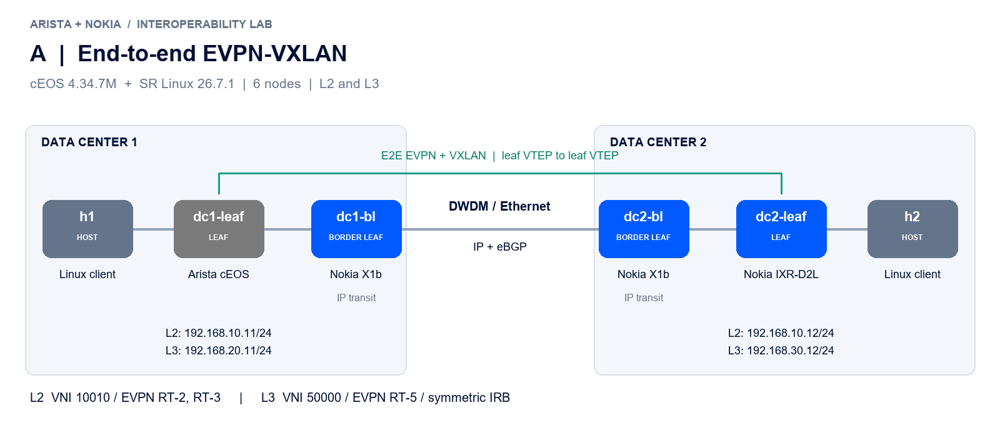
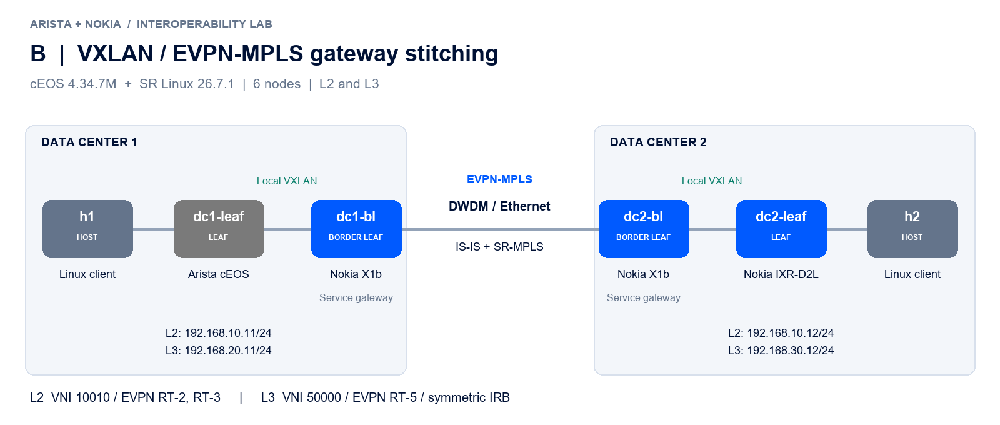
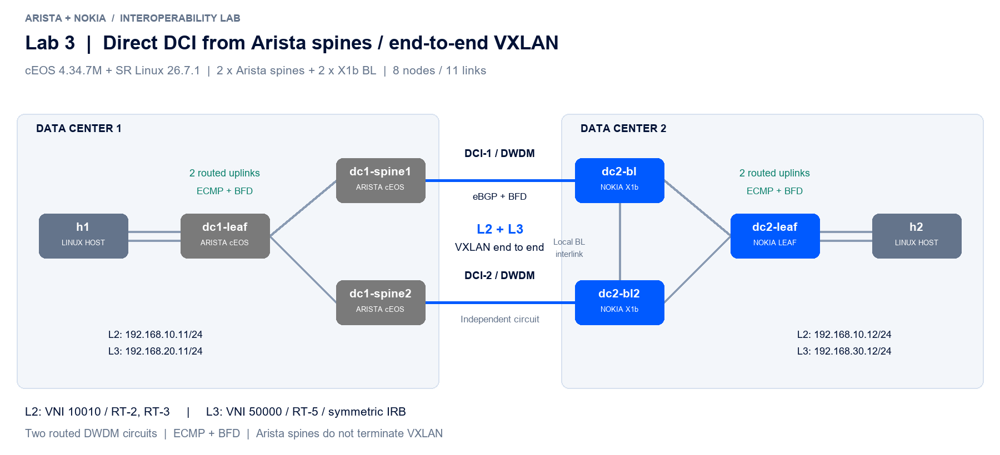

# Arista + Nokia interop and DCI

Reproducible Containerlab examples for **Arista cEOS 4.34.7M ↔ Nokia SR Linux 26.7.1**, connecting Layer 2 and Layer 3 services across two data centers.

Options A and B each have **8 nodes / 12 links**: an Arista leaf, a Nokia leaf, four Nokia IXR-X1b border leafs (two per DC), and two Linux clients. Lab 3 has **8 nodes / 11 links**, replacing the Arista site's Nokia BLs with two Arista spines. Transparent Ethernet/DWDM circuits are represented by veth links.

| Lab | DCI architecture | Border-leaf role | Validation |
|---|---|---|---|
| [Option A](labs/option-a) | End-to-end EVPN-VXLAN over routed IP | IP transit | L2/L3, MTU, 8 single-fault cases; see HA report |
| [Option B](labs/option-b) | Local VXLAN fabrics + EVPN-MPLS over SR-MPLS | Service gateway | L2/L3, MTU, 8 single-fault cases; see HA report |
| [Lab 3](labs/lab3-arista-spines) | Option A with direct DCI from Arista spines | Arista spines + Nokia BLs: IP transit | L2/L3, MTU, 8 single-fault cases, RT and dual-DCI isolation |

## Option A — end-to-end VXLAN



Leaf VTEPs exchange EVPN directly. X1b border leafs route outer IP packets and do not terminate tenant services. L2 uses VNI 10010 and EVPN RT-2/RT-3; L3 uses VNI 50000, EVPN RT-5 and symmetric IRB. Only the selected VTEP/control-plane loopbacks cross the IP underlay.

## Option B — gateway stitching



The X1b gateways terminate each local VXLAN fabric. A multi-instance MAC-VRF stitches L2 to EVPN-MPLS; a separate IP-VRF stitches L3 using two EVPN IFL instances, `allow-export` and D-PATH. The DCI runs IS-IS + SR-MPLS with BFD and TI-LFA. L3 uses two gateway next hops; L2 uses Nokia's shared RD/originating-IP gateway redundancy procedure. Leaf VTEPs are kept within their respective fabrics.

## Lab 3 — direct DCI from Arista spines



Two transit-only Arista spines connect directly to the two Nokia X1b BLs. The Arista site has no Nokia BL and no direct spine interlink. Both leafs keep their VTEPs and tenant gateways. Unique leaf ASNs and a direct multihop eBGP EVPN session provide the minimum control plane for this test. See [Lab 3 configuration and run instructions](labs/lab3-arista-spines) and [its validation report](docs/lab3-validation.md).

## Redundancy

A uses ECMP in the IP underlay plus single-hop BFD. B adds L3 service-gateway ECMP and MPLS transport protection; its L2 stitching requires shared gateway identity and loop-prevention policies. See [the redundancy design and failure tests](docs/redundancy.md). The access leafs and hosts remain single-attached.

## Run a lab

Prerequisites: Linux or WSL2, Docker, Containerlab, locally available NOS images, and an SR Linux license suitable for X1b emulation. This repository contains configuration examples; **it contains no license keys, NOS images, registry addresses or distribution links**.

For WSL, keep an active WSL terminal/session while the lab runs. Systemd services alone do not keep the WSL instance alive; see [Microsoft's explanation](https://learn.microsoft.com/en-us/windows/wsl/systemd). After WSL terminates a distro, use Containerlab to recreate the lab links before repeating tests.

Tag your authorized local images as follows:

```bash
docker tag <your-local-ceos-image> arista_ceos:4.34.7M
docker tag <your-local-srlinux-image> srlinux:26.7.1
docker tag <your-local-network-multitool-image> network-multitool:latest
```

Choose A, B or Lab 3. For example, to run A:

```bash
git clone https://github.com/coolexer/arista-nokia-interop-dci.git
cd arista-nokia-interop-dci/labs/option-a
# Place your license in ./srl.license; it is ignored by Git.
chmod 600 srl.license
chmod +x preflight.sh verify.sh configs/host-init.sh
./preflight.sh
sudo containerlab deploy --topo interop-dci-a.clab.yml
# After startup configuration and BGP convergence:
./verify.sh all
./bum.sh
# Inject and restore single BL, DCI and uplink faults:
./failover.sh
```

For B, use `labs/option-b` and `interop-dci-b.clab.yml`. For Lab 3, use [its run instructions](labs/lab3-arista-spines). `verify.sh l2` and `verify.sh l3` run individual service checks. `preflight.sh` validates files and local prerequisites without deploying or pulling images. Run the labs sequentially when WSL memory is limited. Options A/B contain four X1b simulators; Lab 3 contains two X1b simulators and three cEOS nodes. Allow sufficient startup time and monitor RAM/swap and CPU.

```bash
sudo containerlab destroy --topo interop-dci-a.clab.yml
```

## Explore the topologies

Open the repository in VS Code with the Containerlab extension. Select **Graph (TopoViewer)**: both YAML files have companion `.annotations.json` files with fixed positions, data-center groups and vendor colors. The editable `.clab.drawio` diagrams use the generator invoked by the extension's **Graph (draw.io, Horizontal)** action and the Nokia Modern theme. Arista is grey; Nokia is blue.

## Test design and evidence

The L2 clients share `192.168.10.0/24`. The L3 clients use separate local subnets, `192.168.20.0/24` and `192.168.30.0/24`; those VLANs/BDs have no stretched L2 VNI. This makes the routed test distinct from the L2 test.

`verify.sh` collects control-plane state and checks bidirectional ICMP, inner IP MTU 1500 with DF set, and the encapsulation on the DCI. B additionally captures VXLAN inside both fabrics and MPLS on the DCI. Review imported routes and next hops as well as the PASS message.

- [Validation report](docs/validation.md)
- [Selected Option A CLI and traffic evidence](docs/results/option-a)
- [Selected Option B CLI and traffic evidence](docs/results/option-b)
- [Configuration and acceptance details](docs/design.md)
- [Redundancy mechanisms and failure tests](docs/redundancy.md)
- [Option A HA evidence](docs/results/option-a-ha)
- [Option B HA evidence](docs/results/option-b-ha)
- [Lab 3 validation](docs/lab3-validation.md)

The tested cEOS image reports an **engineering build** of 4.34.7M. Container software forwarding demonstrates protocol interoperability; it does not qualify X1b ASIC performance, production scale, hardware failover timing or DWDM optics. This is an independent lab example, not a vendor certification.

## Documentation

- [Nokia SR Linux 26.7 — EVPN L2](https://documentation.nokia.com/srlinux/26-7/books/vpn-services/evpn-vxlan-tunnels-layer-2.html)
- [Nokia SR Linux 26.7 — EVPN L3](https://documentation.nokia.com/srlinux/26-7/books/vpn-services/evpn-vxlan-tunnels-layer-3.html)
- [Nokia SR Linux 26.7 — inter-domain services and D-PATH](https://documentation.nokia.com/srlinux/26-7/books/vpn-services/inter-domain-vpn-services.html)
- [Nokia SR Linux 26.7 — SR-MPLS with IS-IS](https://documentation.nokia.com/srlinux/26-7/books/advanced-solutions/acg2086-mpls-sr-isis.html)
- [Arista — VXLAN/EVPN sample configurations](https://www.arista.com/en/um-eos/eos-sample-configurations)
- [Containerlab VS Code extension](https://containerlab.dev/manual/vsc-extension/)
