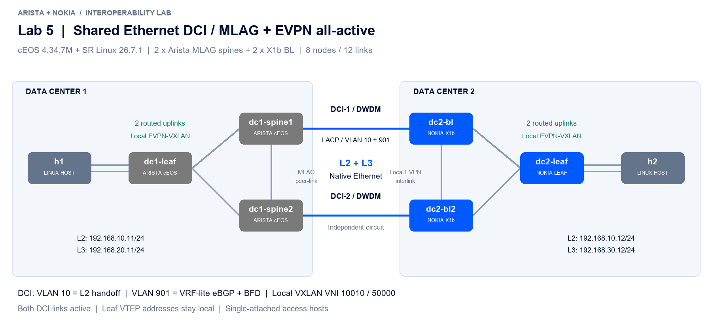

# Lab 5 — shared Ethernet DCI validation

Test date: **2026-10-12**. Environment: Containerlab 0.80.0 in WSL2, **cEOS 4.34.7M** and licensed **SR Linux 26.7.1 X1b** simulators. The access Nokia leaf uses D2L emulation. This is a software interoperability test, not physical 7260CX3 qualification.

The design uses an Arista MLAG pair and a Nokia EVPN all-active Ethernet Segment. **Both DCI trunks carry L2 VLAN 10 and VRF-lite L3 transit VLAN 901.** Each local fabric retains EVPN-VXLAN; the DCI carries native Ethernet. A local Arista peer-link is added to the earlier direct-spine topology. The Arista spines now terminate VXLAN and tenant VRFs.

## Baseline

| Check | Observed result |
|---|---|
| Startup configuration | Clean Containerlab recreation accepted the saved NOS configuration |
| Arista MLAG | Active / Connected, consistent peers; Port-Channel100 active-full |
| LACP | Both DCI members collecting/distributing; common Nokia system ID/key |
| Nokia Ethernet Segment | Up, all-active; both BLs are DF candidates |
| L3 DCI BGP | Four eBGP adjacencies established, two per Arista spine / Nokia BL |
| L3 next hops | Two next hops for the remote tenant prefix |
| BFD | Tenant BFD peers Up; configured 500 ms × 3; captured operating timers must be read independently |
| L2, both directions | 5/5 replies, zero loss and no duplicates |
| L3, both directions | 5/5 replies, zero loss and no duplicates |
| IP MTU 1500, DF | 3/3 replies for both services in both directions |
| DCI capture | VLAN 10 and 901, including tenant payload, on both links; no VXLAN |
| Broadcast ARP | Five requests sent and exactly five delivered in each direction |
| Remote leaf underlay | No remote leaf VTEP route on either side |

The traffic capture includes 100 UDP destination-port variations for each service in each direction. Presence on both circuits establishes active use in this sample; it does not measure hardware hash fairness or throughput.

## Required configuration discovered during the test

The Nokia transit MAC-VRF needs **EVPN ARP synchronization on both IRBs**. Initially, the directly paired BGP sessions established while the crossed sessions could not resolve their return ARP through the other BL. Advertising dynamic ARP through EVPN resolved that failure. Both BLs use `learn-unsolicited true`, `arp evpn advertise dynamic` and ARP timeout 270 seconds. See [Nokia's SR Linux 26.7 EVPN Layer 3 documentation](https://documentation.nokia.com/srlinux/26-7/books/vpn-services/evpn-vxlan-tunnels-layer-3.html).

X1b needs an EVPN dynamic label pool for Ethernet Segment control-plane resources. Without it, the ES reported `no-esi-label`. MPLS is not carried on the DCI. The physical LAG member's generated MTU is deleted before assigning `aggregate-id`; the LAG owns the MTU.

Arista MLAG uses a peer-link and independent management heartbeat with dual-primary detection. Its **reload/recovery delays in this small lab are demonstration values**, not production defaults. [Arista's MLAG documentation](https://www.arista.com/en/um-eos/eos-multi-chassis-link-aggregation) gives platform-dependent reload delays and dual-primary recovery guidance. Recorded cEOS MLAG state shows a heartbeat timeout of 60000 ms; BFD does not replace MLAG peer detection.

## Single-fault tests

Results and continuous ping traces are collected under [the evidence directory](results/lab5). The script pauses one NOS container or disables one interface, checks both services in both directions with the fault still present, flushes endpoint ARP, then restores the fault and all four DCI BGP adjacencies.

**All nine isolated scenarios recovered both services with the fault still present.** The two spine freezes were repeated after correcting the cEOS management interface. The peer-link additionally passed a sustained test with an independent live management heartbeat and exactly one peer's interfaces guarded against dual-primary.

| Fault | L2 + L3 / fresh ARP | Evidence |
|---|---|---|
| Arista spine 1 frozen | PASS, repeated with final management configuration | [Final spine run](results/lab5/failover-spines-final/test.log) |
| Arista spine 2 frozen | PASS, repeated with final management configuration | [Final spine run](results/lab5/failover-spines-final/test.log) |
| Nokia BL 1 frozen | PASS | [Initial full run](results/lab5/failover-initial/test.log) |
| Nokia BL 2 frozen | PASS | [Initial full run](results/lab5/failover-initial/test.log) |
| DCI 1 down | PASS; both services use the other circuit | [Initial full run](results/lab5/failover-initial/test.log) |
| DCI 2 down | PASS; both services use the other circuit | [Initial full run](results/lab5/failover-initial/test.log) |
| Arista leaf uplink 1 down | PASS | [Initial full run](results/lab5/failover-initial/test.log) |
| Nokia leaf uplink 2 down | PASS | [Initial full run](results/lab5/failover-initial/test.log) |
| Arista peer-link down | PASS, also held beyond the detection timer; both service directions and broadcast pass with one guarded peer | [Sustained final test](results/lab5/peer-link-held-final/test.log) |

The initial full run preceded the management-interface correction. Its peer-link snapshots do **not** qualify the independent heartbeat/guard. Use the final sustained test's JSON snapshots for that assertion. cEOS's physical management interface is **Management0**; configuring Management1 reserves an address on an absent interface. The final startup files use Management0 and were recreated successfully from scratch.

**Transient forwarding matters:** initial traces had a longest observed gap between echo replies of **34.22 s** during a spine freeze. This is a sample observation across injection/restoration, not a measured hardware convergence bound. In the final spine rerun, continuous L2 traces recorded **four forward and three reverse duplicate echo replies** during spine 1 rejoining; a separate readiness probe also recorded two duplicates. Strict readiness rejected that sample and accepted the later clean state. The lab therefore establishes functional recovery, not duplicate-free or hitless rejoining. Captured traces contain 200 probes at 0.2-second intervals; a trace can end before complete restoration and is not an upper bound on the outage. The published script uses a longer capture window for subsequent runs. Raw traces and summaries are retained.

Final state is recorded in [final health evidence](results/lab5/final-health): both MLAG trunks active-full, four DCI BGP sessions established, both Nokia ES up, and both services working in both directions. The lab is left running.

## Limits

`docker pause` freezes a NOS while veth carrier stays up; a disabled interface models an explicit link failure. These are different failure modes. Steady-state recovery is the acceptance criterion. Packet loss during detection and restoration is retained in the traces; zero-loss failover and a convergence SLA are not claimed.

The access leaf and clients remain single-attached. The test covers IPv4 unicast, ARP broadcast and MTU; it does not qualify multicast, IPv6, scale, QoS, optics or hardware forwarding. The exact 7260CX3 SKU and deployed EOS release still need a physical check. Arista redundancy here is MLAG, not EVPN ESI multihoming or a hierarchical VXLAN-to-VXLAN L2 gateway.

[Configuration and run instructions](../labs/lab5-shared-ethernet-dci)
