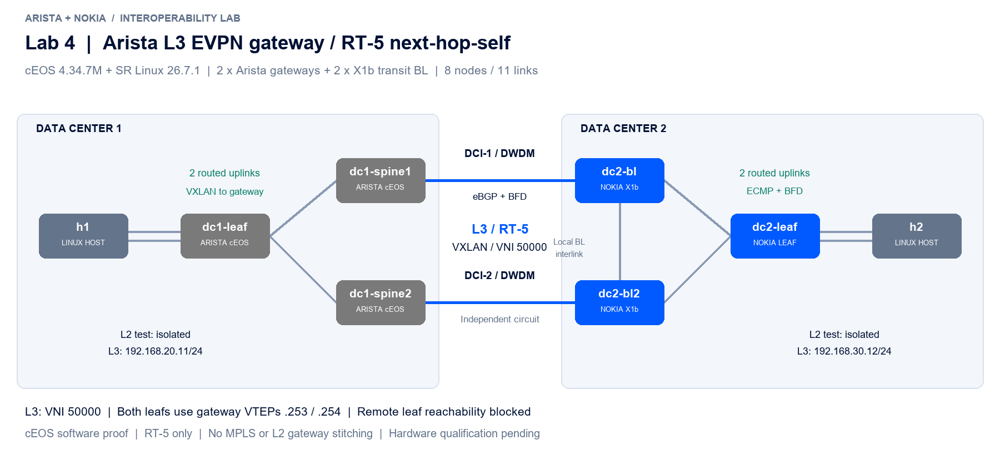

# Lab 4: Arista L3 EVPN gateway

Functional proof of **VXLAN-to-VXLAN L3 EVPN gateway** on the available cEOS 4.34.7M engineering build, using the same eight-node / eleven-link geometry as Lab 3. It does not certify a physical 7260CX3 SKU or customer EOS maintenance release.



Both Arista spines now terminate tenant VXLAN and use RT-5 next-hop-self toward the Arista leaf and the Nokia leaf. Nokia X1b BLs remain IP transit. The Nokia leaf represents the remote VTEP; this test does not configure a Nokia VXLAN-to-VXLAN gateway or a second hierarchy on the Nokia side.

The access leafs have **no direct EVPN session and no IP reachability to each other's VTEP**. Their remote tenant routes instead use gateway VTEPs 10.255.1.253 / .254. Only RT-5 is permitted on gateway EVPN peerings; L2 is deliberately isolated. The gateway preserves the original RD/RT and uses the same tenant VNI 50000 on both VXLAN legs.

The essential EOS command is:

```text
router bgp 65201
   address-family evpn
      neighbor default next-hop-self received-evpn-routes route-type ip-prefix
   vrf TENANT
      router-id 10.255.1.254
      rd 10.255.1.254:50000
      route-target import evpn 65000:50000
      route-target export evpn 65000:50000
```

The explicit **VRF router-id is required in this interface-free gateway configuration**. There is no tenant SVI from which EOS can choose an address automatically. See the complete startup configs, including Vxlan1 and peer settings.

## Run

Use the local image tags and private X1b license procedure in the [main README](../../README.md); `jq` is required. Run this separately from the other heavy WSL labs.

```bash
cd labs/lab4-arista-l3-gateway
# Place the private license in ./srl.license (ignored by Git).
chmod 600 srl.license
./preflight.sh
sudo containerlab deploy --topo interop-dci-4.clab.yml
# Wait for EOS startup configuration and all BGP/BFD sessions.
./verify.sh
./failover.sh
sudo containerlab destroy --topo interop-dci-4.clab.yml
```

`verify.sh` tests bidirectional L3, DF MTU 1500, gateway FIB next hops, blocked remote-leaf reachability, separate VXLAN legs and expected L2 isolation. `failover.sh` pauses each Arista gateway separately and disables each DCI separately, requiring L3 recovery with the fault still present and control-plane restoration between cases. It restores a pending fault on exit.

TopoViewer annotations and an editable draw.io diagram are included. Addressing follows Lab 3, except management subnet 172.31.250.0/24 and gateway roles/EVPN peers. No licenses, NOS distributions or distribution URLs are included.

See [the result and options for 7260CX3](../../docs/7260cx3-dci-options.md). This is **plain RT-5 gateway ECMP**, not an ESI all-active gateway, L2 stitching, MPLS interworking or a D-PATH design.
