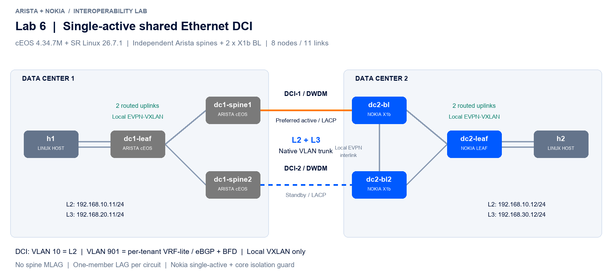

# Lab 6: single-active DCI with independent Arista spines



Two independent Arista spine VTEPs connect to two Nokia X1b BLs. Each circuit is an ordinary **one-member LACP LAG**. The Nokia pair uses **EVPN single-active and LACP standby signaling**. One trunk carries both L2 and L3 while the other remains standby. Each Arista spine has its own VTEP address. There is no Arista spine peer-link, shared spine VTEP or MLAG.

## Service and redundancy design

| Item | Configuration |
|---|---|
| NOS | cEOS 4.34.7M engineering build, SR Linux 26.7.1 |
| Size | 8 nodes / 11 links |
| L2 service | VLAN 10, local VNI 10010, clients in 192.168.10.0/24 |
| L3 service | Separate local networks 192.168.20.0/24 and 192.168.30.0/24 |
| DCI L3 transit | VLAN 901, one /31 per circuit, per-tenant eBGP + BFD |
| Circuit 1 | spine1 Ethernet2/Po100 to BL1 ethernet-1/2/lag1 |
| Circuit 2 | spine2 Ethernet2/Po100 to BL2 ethernet-1/2/lag1 |
| Nokia ES | ESI 00:01:00:00:00:00:00:00:06:01, single-active, preference DF, AC-DF excluded, non-revertive |
| Standby signal | LACP out-of-sync; the Arista standalone port-channel becomes inactive |
| Local fabric protection | Arista link tracking; Nokia EVPN core event handler |
| Infrastructure separation | Leaf VTEP addresses and inter-site EVPN remain local to each fabric |

LACP runs in fast mode. BFD protects L3 eBGP neighbors. **BFD alone does not switch the L2 ES.** Nokia LACP standby signaling makes the entire LAG inactive, including its routed VLAN 901 subinterface. A newly active eBGP session must converge before L3 resumes. Both services use active/standby DCI, with no DCI ECMP.

On Arista, each physical fabric uplink is upstream in `FABRIC` link tracking and the DCI member is downstream. In this minimal lab, loss of the sole local uplink shuts that DCI member. With multiple production fabric links, add all relevant links and select the required threshold.

On Nokia, `DCI-CORE` monitors only the two local EVPN peer sessions. When none is established, the native SR Linux event handler gates the DCI physical member. When at least one is established, the event handler permits the member; EVPN DF and LACP still govern whether the LAG can forward. The script uses ephemeral operational state rather than changing persistent interface configuration. Monitor the event handler's operational state and errors.

The BLs use **different ASNs (65202 and 65203)**. This lets their loopback and EVPN reachability use the Nokia leaf if the direct BL interlink fails. Reusing one ASN without an explicit AS-loop/reachability design would make that interlink a control-plane dependency.

DF preference is 200 on BL1 and 100 on BL2. Non-revertive behavior can leave BL2 active after recovery. Diagram colors show preferred initial roles, not live state. Hosts and access leafs are single-attached; this lab qualifies DCI redundancy rather than access-node redundancy.

## Run

Use locally authorized images with the tags in the topology and a suitable `srl.license` next to the YAML. The repository supplies no NOS image, license key, registry or distribution URL.

```bash
cd labs/lab6-single-active-dci
chmod 600 srl.license
chmod +x *.sh configs/host-init.sh
./preflight.sh
sudo containerlab deploy --topo interop-dci-6.clab.yml
# Wait for startup configuration and protocol convergence.
./verify.sh
./bum.sh
# Each invocation restores its fault before exit.
./failover.sh dci1
./failover.sh dci2
./failover.sh arista-uplink1
./failover.sh arista-uplink2
./failover.sh nokia-uplink1
./failover.sh nokia-uplink2
./failover.sh pause-spine1
./failover.sh pause-spine2
./failover.sh pause-bl1
./failover.sh pause-bl2
./failover.sh nokia-peer
./failover.sh nokia-core1
./failover.sh nokia-core2
./failover.sh evpn-core1
./failover.sh evpn-core2
sudo containerlab destroy --topo interop-dci-6.clab.yml
```

`verify.sh traffic` checks the data plane without collecting the full CLI snapshot. Logs go to ignored `results/` directories. The fault tests include fresh ARP while a fault is held. Continuous traces retain transient loss and any duplicates; a PASS requires stable bidirectional L2/L3 with the fault present, not a hitless transition.

Open the YAML in the VS Code Containerlab extension and use Graph / TopoViewer. The companion annotations set vendor colors and positions. The `.clab.drawio` file provides an editable topology.

## Qualification boundary

cEOS does not emulate a 7260CX3 ASIC. This lab tests base VXLAN/EVPN, standalone LACP and routing functions. Exact physical SKU/EOS support, scale and optical behavior need production qualification. DWDM must transparently carry LACP PDUs as well as tagged service frames. veth links represent transparent Ethernet/DWDM, not an optical line system. A paused NOS retains carrier and is a software freeze test, not a physical power-off.

For a deployment with more than two sites, use a separate ES/LAG per independent Arista site. Exclude every parallel L2 service path for the same stretched VLAN/VNI through existing inter-site connectivity, including EVPN-VXLAN paths between Arista sites. Routed physical links can still carry a stretched VXLAN VNI and therefore do not by themselves remove the service loop. ES split-horizon does not remove every possible external multi-site bridging loop.

[Validation report](../../docs/lab6-validation.md)

## Primary documentation

- [Nokia SR Linux 26.7 EVPN L2, single-active and LACP standby](https://documentation.nokia.com/srlinux/26-7/books/vpn-services/evpn-vxlan-tunnels-layer-2.html)
- [Nokia SR Linux 26.7 event handler](https://documentation.nokia.com/srlinux/26-7/books/event-handler/event-handler-configuration.html)
- [Nokia operational groups](https://documentation.nokia.com/srlinux/26-7/books/event-handler/operational-groups-overview.html)
- [Arista link tracking and link-down MAC flushing](https://www.arista.com/en/um-eos/eos-data-transfer)
